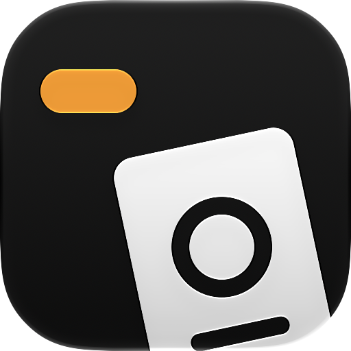

<p align="center"></p>

# Supa Visa

Supa Visa is a self-hosted IP allowlist for services behind Cloudflare, opened with a passkey from your phone.

Confirm with a passkey, and your current IP can reach the hostnames you registered for the next few hours. When
the time is up, the IP is removed on its own. The services themselves need no changes: no login page, no SDK, no
proxy that apps have to understand. That suits admin panels, NAS dashboards and app API endpoints that cannot
follow a login redirect.

> **Early development.** Nothing is released yet, and the Docker image in the quick start is published with the
> first release.

## Features

- **No changes to your services:** a Cloudflare WAF rule in front of each registered hostname lets through only
  the IPs on Supa Visa's list. Hostnames you do not register are left alone.
- **Passkeys only:** issuing, revoking and managing passkeys each need a fresh passkey check. There are no
  passwords and no recovery page; a lost passkey is reset from the server's shell.
- **Visas expire on their own:** a visa is an IP and an expiry time. Once it expires or you revoke it, the IP is
  gone from the list within about a minute.
- **Optional renewal:** before a visa expires, Supa Visa asks Cloudflare's analytics whether the address is still
  in use and extends it if so, up to a hard limit that always needs a new passkey check.
- **A push for every visa:** through [Bark](https://github.com/Finb/Bark), so a visa you did not issue yourself
  shows up right away.
- **Failed sign-ins are blocked:** more than three in a day from one network block it for seven days.
- **Small:** one Node process, one JSON file, two runtime dependencies, and only free Cloudflare features. Images
  are built for amd64 and arm64.

## Requirements

- Services reachable only through a Cloudflare Tunnel. A service that also listens on a public port can be
  reached around the WAF rule.
- A Cloudflare account with one IP list that only Supa Visa uses, and an API token that can edit that list, read
  your zones and edit WAF rules in the zones you protect. The free plan is enough.
- Docker.

## Quick start

```sh
mkdir supa-visa && cd supa-visa
curl -O https://raw.githubusercontent.com/supacode-org/supa-visa/main/deploy/compose.yaml
curl -o supa-visa.env https://raw.githubusercontent.com/supacode-org/supa-visa/main/.env.example
echo "TUNNEL_TOKEN=<your tunnel token>" > tunnel.env
# fill in supa-visa.env, then:
docker compose up -d
docker compose logs supa-visa   # the first-time setup code is here
```

Open Supa Visa's own hostname on your phone, enter the setup code and register a passkey. The
[deployment guide](docs/deployment.md) covers the Cloudflare settings, protecting services, notifications and
renewal.

On the server:

```sh
docker compose exec supa-visa supa-visa reset-passkeys               # lost a passkey: back to setup mode
docker compose exec supa-visa supa-visa reset-passkeys --revoke-all  # a passkey may be stolen: also revoke every visa
docker compose exec supa-visa supa-visa unblock 203.0.113.7          # lift the block on this address's network
```

## Limitations

- **It is a coarse, IP-based gate,** not a replacement for Cloudflare Access or a VPN, and only for HTTP services
  behind Cloudflare. Use those for SSH and databases.
- **Everyone sharing your public IP gets in with you** while the visa lasts: carrier-grade NAT, hotel or café
  Wi-Fi. IPv6 is let in as a /64 by default.
- **Blocks cover a whole network** (an IPv4 /24 or an IPv6 /48). A neighbour's failed sign-ins can block you too;
  lift it with `unblock`.
- **Your other address is looked up with public services** (ipify, ip.sb, icanhazip, Cloudflare, ident.me), which
  see your address and could report a wrong one. Check it before you confirm, or untick it.
- **While Supa Visa is down, visas do not expire.** They are removed when it starts again.
- **Renewal needs the Analytics permission,** and requests answered from Cloudflare's cache do not count as use.

## Development

Supa Visa runs on Node 24 directly from TypeScript, with no build step.

```sh
npm install
scripts/test.sh   # type check and every test
```

## Acknowledgements

Passkeys are handled by [SimpleWebAuthn](https://github.com/MasterKale/SimpleWebAuthn), and notifications are sent
with [Bark](https://github.com/Finb/Bark).

## License

[MIT](LICENSE)
